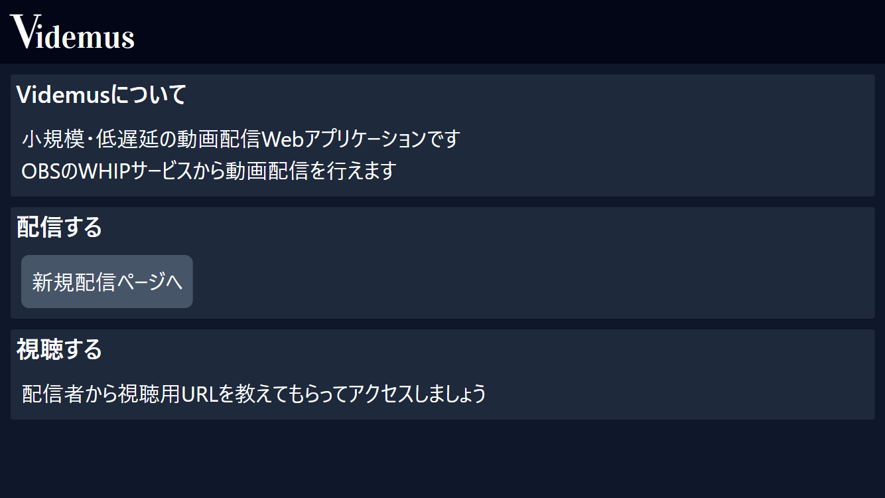
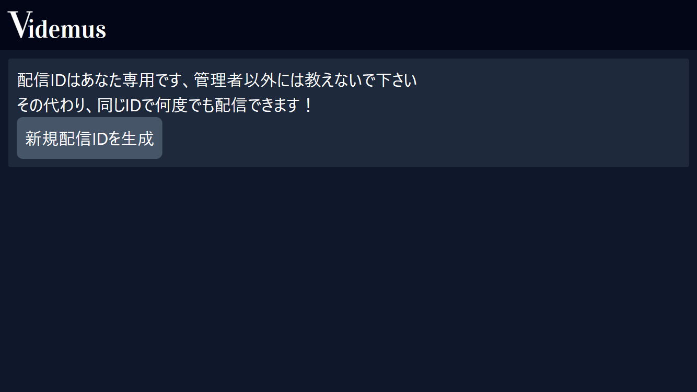
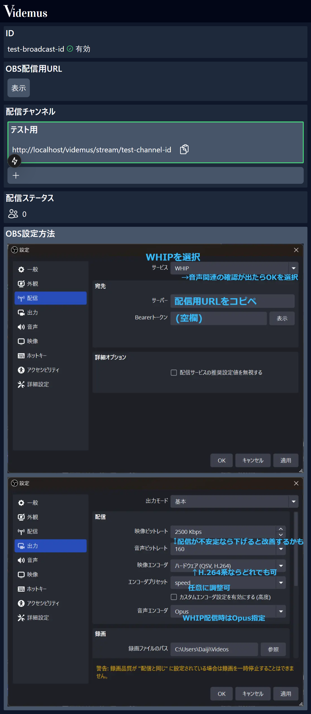

# 小規模・低遅延動画配信サーバ/クライアント videmus

[mediasoup](https://mediasoup.org/) を用いた、
少人数でのゲーム画面配信を目的とした
動画配信・視聴Webアプリケーションです。

## 使用方法
videmusが`https://videmus.example.com`に配置されているとして
使用方法を説明します

`https://videmus.example.com` にアクセスすれば
簡易的な説明付に従って配信・視聴できます

### 配信方法
#### 配信ID発行
`https://videmus.example.com/broadcast` は、新しい配信者として
登録するための画面です

「新規配信IDを生成」ボタンを押します。

配信用IDが無効状態で発行され、 配信管理用ページに遷移します

> [!IMPORTANT]
> 配信用IDは管理者を除く他の人には秘密にするか、少人数でのみ共有して下さい
>
> これはVidemusにおけるあなたの身分証で、
> 第三者に知られた場合、配信を乗っ取られてしまいます

#### 配信管理用ページ
配信管理用ページは `https://videmus.example.com/broadcast/<配信用ID>` にあります。
ここでは配信・視聴状況の確認と設定を行うことが出来ます。

配信を行うために、管理者と連絡を取って配信IDを伝え、 有効化する様に伝えてみて下さい。
（全文字でなく、最初の5~6文字でも十分に伝わります）

管理者は伝えられたIDについて、
`BroadcastIds` テーブルの `is_available` 列を
`0` から `1` に書き換えて有効化します
（現在のところは直接データベース内の該当行を編集します）

OBS配信設定もこのページに一緒に示されています。

スクリーンショットの設定に従ってOBSで配信を開始しましょう。

配信管理用ページで視聴用URLがコピーできますので、
それを視聴者に伝えれば、配信者の準備は完了です。

### 視聴方法
配信者から伝えられた視聴用URLにアクセスします。

## 仕様

仕様の正典は [`prd/`](./prd/README.md) です。開発時の入口は [`AGENTS.md`](./AGENTS.md) にまとめています。

## 開発環境の起動

ホストに `node_modules` は置かず、すべてコンテナ内で動かします（[prd/02](./prd/02-architecture.md) §4）。

1. Git リポジトリをクローンします
2. 次の環境変数ファイルを用意します（変数の意味は [prd/02](./prd/02-architecture.md) §5）
   - `.env.database`: `DB_HOST=database` / `MYSQL_USER` / `MYSQL_PASSWORD` / `MYSQL_DATABASE` /
     `MYSQL_ROOT_PASSWORD` / `TEST_BROADCAST_ID`（試験用に最初から有効にする配信 ID）/
     `TEST_CHANNEL_ID`（試験用のチャンネル ID）
   - `.env.next`: `NEXT_PUBLIC_HOST_URL` / `NEXT_PUBLIC_API_URL` / `API_URL` / `API_KEY`
   - `.env.resource-server`: `API_KEY` / `CORS_ORIGINS`
   - `.env.media-server`: `ANNOUNCED_IP` / `WEBRTC_PORT`
3. DTLS の証明書と秘密鍵を `media-server/dtls-cert.pem` と `media-server/dtls-key.pem` に置きます
4. `docker compose up` を実行すると、DB の準備（スキーマの作成と試験データの投入）のあとに
   next（3000）・resource-server（4000）・media-server（4001、WebRTC 44400）が起動します。
   DB のデータは起動のたびに消えます

## 配置

next は Vercel に、resource-server と media-server は VPS 上の docker compose に置きます。
サーバのイメージは `./scripts/push-images.sh` で `ghcr.io/daiius/videmus-*` にビルド・push します
（事前に ghcr.io へ `docker login`）。詳細は [prd/02](./prd/02-architecture.md) §3 にあります。
