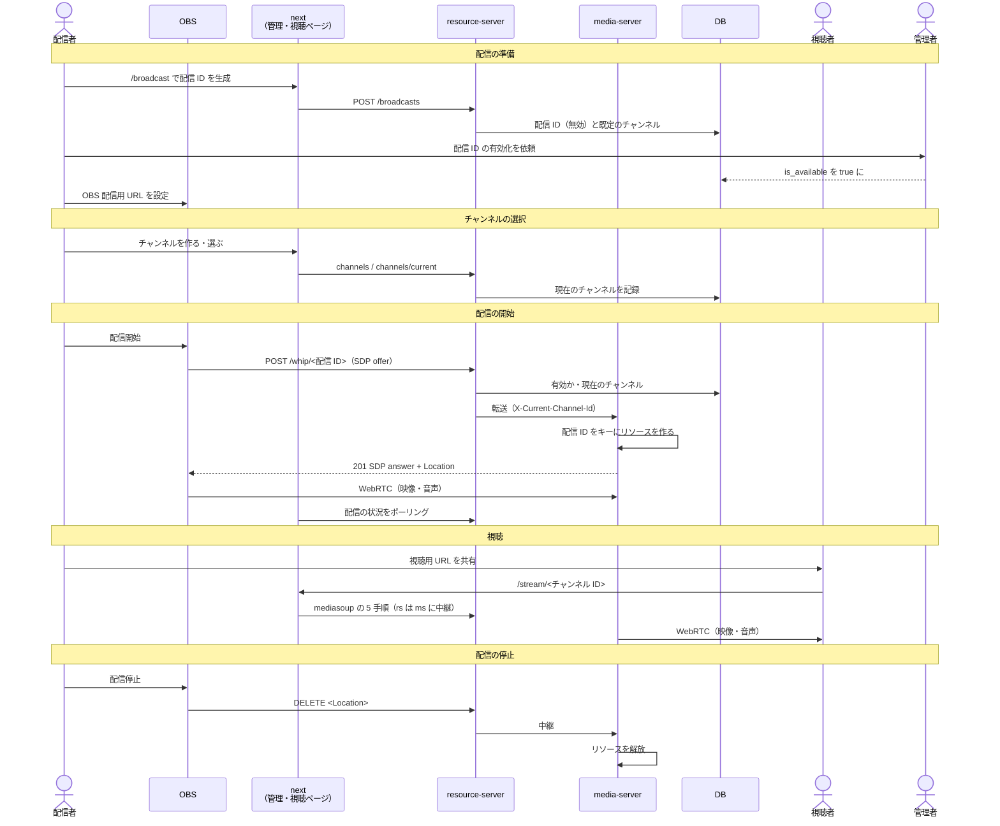

# 01. 体験とプロダクト動機

## 1. 動機

友人とゲーム画面を共有しながら通話して遊んでいる。そのとき使っていた配信手段（Stream Broadcast）の
**遅延と画質が少々ストレス**だったのが発端で、「低遅延な動画配信サーバを自分で作れないか」と考えた。

- 目標は **遅延と画質の両方に満足できること**。実測で遅延は 0.6 秒程度。
- Nginx の RTMP モジュールも試したが、10 秒程度の遅延を解消できず用途に合わなかった。
  WebRTC（SFU）を選んだのはこのため。

## 2. 想定する利用者と規模

- **配信者**: 友人などの身内。管理者（運営者本人）と直接連絡が取れる人。
- **視聴者**: 配信者から URL を教えてもらった人。
- **規模**: 同時に配信するのは数本、1 配信あたりの視聴者は 10 人程度まで（[04](./04-media.md) §6）。
  不特定多数への公開は想定しない。サーバの負荷が持たないため、配信 ID は管理者が手動で有効化する。

## 3. 利用の流れ

### 3.1 配信の準備（初回のみ）

1. 配信者が `/broadcast` で「新規配信 ID を生成」を押す。配信 ID が**無効の状態**で作られ、
   既定のチャンネルが 1 つ付く。管理ページ `/broadcast/<配信 ID>` に移る。
2. 配信者は管理者に配信 ID を伝える（先頭 5〜6 文字でも足りる）。
3. 管理者が配信 ID を有効化する（現状は DB の `is_available` を直接書き換える。[07](./07-roadmap.md) §3）。
4. 配信者は管理ページに出る **OBS 配信用 URL**（`<API の URL>/whip/<配信 ID>`）を OBS の WHIP サービスに設定する。
   管理ページには OBS の設定方法の画像も載せている。

同じ配信 ID で何度でも配信できる。OBS に毎回違う URL を設定し直さなくて済むように、
配信 ID は配信者ごとに固定で割り当てる。

### 3.2 チャンネルの選択

配信者は管理ページでチャンネルを最大 5 つまで作り、名前を付け、どれに配信するかを選ぶ。
チャンネルごとに視聴用 URL が決まっている。

- **チャンネルを設けた理由**: OBS はフレームレートの低下などで切断・再接続することがあり、
  以前は再接続のたびに視聴用 URL がリセットされていた。視聴用 URL を配信ごとに作り直すのではなく、
  配信者が持つチャンネルに固定することで、再接続しても同じ URL で見られるようにした。
- 配信の内容に応じて URL を分けられる。たとえばホラーゲームの配信に普段と同じ URL を使い回すと、
  別の配信のつもりで開いた人を驚かせてしまう。
- 1 人の配信者は同時に 1 配信しかしない、と仮定している。そのため「いまどのチャンネルに配信しているか」を
  1 つ選ぶだけで済む。
- **配信中にも切り替えられる**（あるべき姿）。切り替えると、新しいチャンネルの視聴用 URL で
  すぐに見られるようになる。**gap**: 現状は配信中の切り替えが media-server まで届かず、
  配信をやり直すまで新しい URL では見られない（[04](./04-media.md) §2.3、[07](./07-roadmap.md) §2）。

### 3.3 配信と視聴

1. 配信者が OBS の配信ボタンを押す。管理ページの「配信ステータス」に視聴者数が出る（5 秒ごとに更新）。
2. 配信者が視聴用 URL を視聴者に伝える。管理ページには、現在のチャンネルの URL にだけコピーボタンが出る。
3. 視聴者が URL を開くと再生が始まる。自動再生のため**最初はミュートで始まる**ので、
   音声はプレーヤーで解除する。
4. 配信者が OBS で配信を止めると、サーバのリソースが解放される。

### 3.4 全体の流れ

### 3.5 配信が途切れたとき（あるべき姿）

OBS が切断・再接続しても、視聴者は**何もしなくても再生が再開する**。
**gap**: 現状は視聴者がページを再読み込みする必要があり、サーバ側にも古いリソースが残る
（[04](./04-media.md) §5）。

## 4. 類似サービスとの違い

| サービス | 似ている点 | 違い |
|---|---|---|
| Google Meet | WebRTC による低遅延なブラウザ配信 | 無料プランでは 1 対 2 以上の配信が 1 時間ごとに切れる。会議向けの UI。OBS とは仮想カメラ経由でしかつながらない |
| Sora（時雨堂） | WebRTC SFU による低遅延な配信 | 映像・音声・データの配信から録画まで扱える多機能な製品 |

Videmus は **OBS から直接（WHIP で）受けて、URL だけで視聴させる**ことに絞っている。
